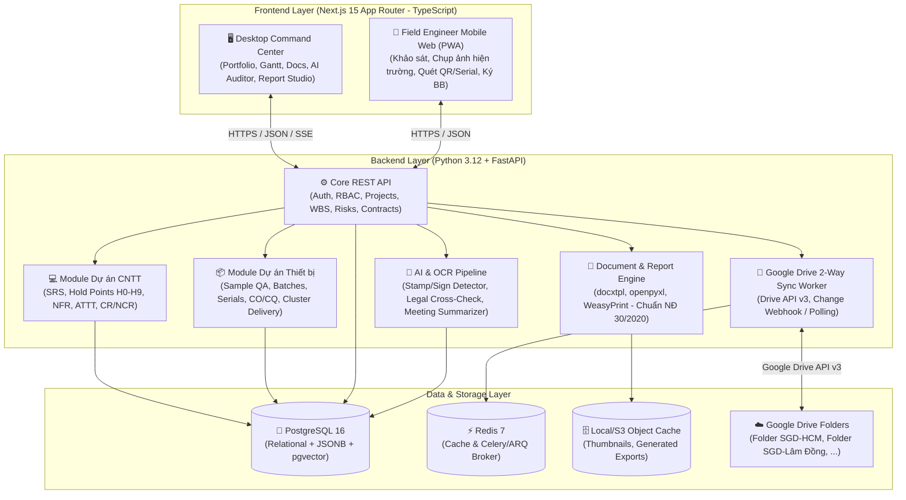
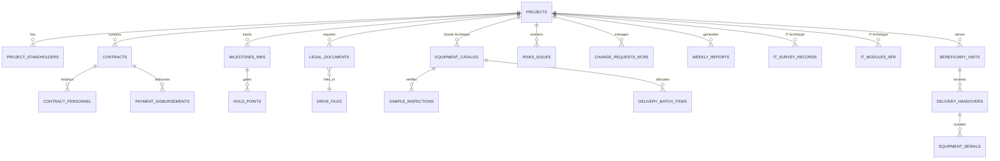

# 🏛️ TECHNICAL SPECIFICATION: HỆ THỐNG QUẢN TRỊ & GIÁM SÁT ĐA DỰ ÁN ĐẦU TƯ CÔNG (PMIS - GOVTECH EDITION)

> **Tài liệu Đặc tả Kỹ thuật & Nghiệp vụ (Product & Technical Specification)**  
> **Mục tiêu:** Dùng làm tài liệu thiết kế gốc (Single Source of Truth) để **Claude Code** trực tiếp hiện thực hóa toàn bộ hệ thống (Fullstack: Next.js + Python FastAPI + PostgreSQL).  
> **Phạm vi khởi điểm:** Quản lý trực tiếp 02 dự án trọng điểm đang chạy khẩn cấp và mở rộng không giới hạn cho các dự án đầu tư công (CNTT, Mua sắm trang thiết bị, Xây lắp cơ bản) trong tương lai:
> 1. **Dự án 1 (Loại dự án: CNTT / Phần mềm):** *"Xây dựng hệ thống quản lý dữ liệu về cơ sở vật chất và thiết bị trường học"* — **Sở GD&ĐT TP.HCM** (~6 tỷ VNĐ, 120 ngày, phạm vi ~1.670 trường học sau sáp nhập TP.HCM - Bình Dương - Bà Rịa Vũng Tàu, 10 điểm dừng H0–H9, 89 đầu mục hồ sơ pháp lý).
> 2. **Dự án 2 (Loại dự án: Mua sắm hàng hóa / Thiết bị trường học):** *"Mua sắm trang thiết bị dạy học tối thiểu lớp 10 trên địa bàn tỉnh Lâm Đồng"* — **Sở GD&ĐT Lâm Đồng** (~106,225 tỷ VNĐ gói chính + các gói tư vấn, 120 ngày, triển khai giao nhận lắp đặt 3 đợt tại 62 trường chia 4 cụm thuộc khu vực Đắk Nông cũ & Bình Thuận cũ, quản lý hàng mẫu, CO/CQ, hàng ngàn số Serial và ~240 biên bản bàn giao).

---

## 1. Tầm nhìn Sản phẩm & Giải quyết Bài toán Cấp thiết (Executive Summary)

### 1.1. Nỗi đau thực tế (Pain Points) từ 2 Dự án đang triển khai
Qua quá trình điều hành thực tế tại **SGD-HCM** và **SGD-Lâm Đồng**, đội ngũ Ban QLDA / Tư vấn Quản lý dự án (TVQLDA) và Tư vấn Giám sát (TVGS) đang đối mặt với 6 thách thức sống còn:
1. **Rối loạn hồ sơ pháp lý & phiên bản (Document Chaos):** Một dự án đầu tư công có từ 80–150 đầu mục văn bản (từ Chủ trương đầu tư, BCKTKT, KHLCNT, E-HSMT, E-HSDT, Thương thảo, Hợp đồng, Bảo lãnh, Đề cương TVGS đến Biên bản nghiệm thu). Nhiều văn bản đang ở dạng `.docx` dự thảo chưa ký, hoặc đã có bản `.pdf` ký đóng dấu trên Google Drive nhưng không khớp checklist, thậm chí sai sót pháp lý nghiêm trọng (ví dụ: ủy quyền ký bảo lãnh ACB hết hạn, trùng số CCCD nhân sự chủ chốt, thiếu Điều 2 biên bản nghiệm thu, thiếu hóa đơn).
2. **Đứt gãy tiến độ Đường găng & Điểm dừng (Critical Path & Hold Points):**
   - Với **Dự án CNTT (SGD-HCM)**: Có 9 mốc lớn (M1–M9) và 10 điểm dừng giám sát (H0–H9), 10 bộ Checklist (CL-01 → CL-10), xử lý Phiếu yêu cầu thay đổi (CR) và Báo cáo sự không phù hợp (NCR). Khi M1 chậm 16 ngày, toàn bộ các mốc sau phải tính toán lại tiến độ cuốn chiếu để giữ bằng được mốc M8 (30/11) và giải ngân M9 (09/12).
   - Với **Dự án Mua sắm Thiết bị (SGD-Lâm Đồng)**: Giao hàng 3 đợt (Đợt 1: Tin học 60 trường; Đợt 2: Ngoại ngữ + Bàn ghế 37 trường; Đợt 3: Thiết bị các môn 61 trường) chia làm 4 Cụm địa lý. Mỗi trường phải giao hàng - lắp đặt - chạy thử - ký biên bản ngay trong ngày.
3. **Cơn ác mộng kiểm soát Hàng mẫu, Serial, CO/CQ & Biên bản hiện trường:** Tại Lâm Đồng, cần đối chiếu 21 tiêu chí kỹ thuật bộ máy tính mẫu, quản lý 1.420 bộ PC (thùng máy + màn hình) gắn với từng trường, kiểm tra CO/CQ trước khi giao, và sinh tự động hơn 240 file Biên bản bàn giao Word (`.docx`) kèm phụ lục Serial theo từng đợt cho 62 trường (lưu ý ghi song song *Tên trường mới + Tên trường cũ trước sáp nhập*).
4. **Áp lực Báo cáo tuần & Biên bản giao ban (Weekly Reporting Burden):** Thứ Sáu hàng tuần, TVQLDA và TVGS phải tổng hợp số liệu từ hiện trường, đối chiếu kế hoạch vs. thực tế để xuất **Báo cáo công tác QLDA tuần**, **Báo cáo giám sát tuần** và **Meeting Note giao ban** đúng chuẩn thể thức văn bản hành chính nhà nước (Nghị định 30/2020/NĐ-CP).
5. **Rủi ro Thời hạn Hợp đồng Tư vấn & Giải ngân:** Hợp đồng TVQLDA / TVGS (120–180 ngày) rất dễ hết hạn trước khi gói thầu chính kết thúc nếu gói chính bị trễ, tạo ra "khoảng trống pháp lý giám sát".
6. **Phân mảnh công cụ:** Dữ liệu nằm rải rác trên Google Drive, file Excel rời rạc, tin nhắn Zalo và ghi âm cuộc họp (`.m4a`/`.txt`).

### 1.2. Định vị Hệ thống (System Positioning)
**PMIS (Project Management Information System)** là nền tảng Web App (Desktop Quản trị + Mobile Web Hiện trường) dành riêng cho **Đội ngũ Quản lý dự án, Tư vấn QLDA và Tư vấn Giám sát**:
- **Multi-Project & Archetype-Driven:** Quản lý nhiều dự án cùng lúc trên một nền tảng. Mỗi dự án có thể kích hoạt các **Module chuyên biệt (Project Archetypes)**:
  - `IT_SYSTEM_ARCHETYPE` (Khảo sát SRS, Thiết kế, Dev/Test 3.600 CCU, ATTT Cấp độ 3, Pentest, UAT, Chuyển đổi dữ liệu).
  - `GOODS_PROCUREMENT_ARCHETYPE` (Kiểm tra hàng mẫu, Quản lý lô hàng/CO/CQ, Quét & phân bổ Serial/IMEI, Điều phối giao nhận theo Cụm/Đợt, Nghiệm thu lắp đặt tại điểm trường).
  - `CONSTRUCTION_HYBRID_ARCHETYPE` (Mở rộng tương lai cho cải tạo phòng học, lắp đặt hạ tầng mạng/điện).
- **Google Drive 2-Way Sync:** Không thay thế Google Drive mà biến Google Drive của từng dự án thành kho lưu trữ vật lý đồng bộ 2 chiều với Database của phần mềm.
- **AI-Powered Legal & Technical Auditor:** Tích hợp LLM + OCR (Python) để tự động đọc file `.docx`/`.pdf`/`.xlsx` trên Drive, phát hiện văn bản đã có chữ ký/con dấu chưa, cảnh báo mâu thuẫn hợp đồng, bóc tách biên bản họp và tự động điền số liệu vào mẫu Báo cáo tuần `.docx`.

---

## 2. Kiến trúc Kỹ thuật Tổng thể (Technical Architecture)

### 2.1. Sơ đồ Kiến trúc Hệ thống (System Architecture Diagram)



### 2.2. Tech Stack Chi tiết (Chỉ định cho Claude Code)

| Tầng (Layer) | Công nghệ chỉ định | Lý do lựa chọn & Thư viện cốt lõi |
| :--- | :--- | :--- |
| **Monorepo Structure** | Docker Compose + Makefile / Turborepo | Dễ dàng chạy `docker compose up` hoặc dev local với 2 thư mục `apps/web` và `apps/api`. |
| **Frontend (`apps/web`)** | **Next.js 15 (App Router)**, React 19, TypeScript | SSR/CSR linh hoạt, hỗ trợ Mobile PWA cho kỹ sư hiện trường. |
| **UI & Styling** | **Tailwind CSS v4** + **shadcn/ui** + **Lucide Icons** | Giao diện chuyên nghiệp, hiện đại, mật độ thông tin cao (High-density Enterprise UI). |
| **State & Data Fetching** | **TanStack Query v5** + **Zustand** + **React Hook Form (Zod)** | Quản lý cache API, optimistic updates cho checklist và bảng tiến độ. |
| **Data Visualization** | **Recharts** + **TanStack Table v8** + Custom Gantt/Kanban | Bảng dữ liệu lớn (hàng ngàn Serial/trường học), lọc/nhóm theo Cụm, biểu đồ S-Curve giải ngân. |
| **Mobile Field Tools** | `html5-qrcode` / Barcode Detector API + Browser Image Compression | Quét mã vạch/Serial thiết bị bằng camera điện thoại, chụp ảnh nén kèm tọa độ GPS/Timestamp. |
| **Backend (`apps/api`)** | **Python 3.12** + **FastAPI** + **Pydantic v2** | Tốc độ cao, tự động sinh OpenAPI/Swagger, hệ sinh thái xử lý văn bản và AI mạnh nhất. |
| **ORM & Database** | **SQLAlchemy 2.0 (Async)** + **Alembic** + **PostgreSQL 16** | Hỗ trợ `JSONB` cho các thuộc tính động của từng loại dự án (CNTT vs Hàng hóa). |
| **Background Jobs** | **ARQ** hoặc **Celery** + **Redis 7** | Xử lý bất đồng bộ khi đồng bộ Google Drive, quét OCR file PDF và xuất hàng loạt 240 biên bản Word. |
| **Document Processing** | `python-docx`, `docxtpl` (Jinja2 for Word), `openpyxl`, `pypdf`, `pdf2image` | Giữ nguyên 100% định dạng văn bản hành chính nhà nước khi xuất Báo cáo tuần, Tờ trình, Biên bản bàn giao. |
| **Google Drive Integration** | `google-api-python-client`, `google-auth` | Đồng bộ cấu trúc cây thư mục, theo dõi thay đổi file, tải file về phân tích và upload bản xuất tự động. |
| **AI & Document Intelligence** | Anthropic Claude API / Gemini API (qua SDK chuẩn) | Đọc hiểu hợp đồng, rà soát lỗi pháp lý, trích xuất biên bản họp từ file `.txt`/`.m4a`. |

---

## 3. Phân hệ Nghiệp vụ Chi tiết (Detailed Functional Modules)

Hệ thống gồm **8 Phân hệ (Modules)** liên kết chặt chẽ, giải quyết trọn vẹn bài toán của cả dự án **SGD-HCM**, **SGD-Lâm Đồng** và các dự án tương lai:

### Phân hệ 1: Quản trị Danh mục Đa Dự án & Khởi tạo Thông minh (Multi-Project Portfolio & Onboarding)
1. **Multi-Project Command Center (Trang chủ Ban Giám đốc / PM):**
   - Hiển thị toàn cảnh sức khỏe (Health Status: `ON_TRACK`, `AT_RISK`, `DELAYED`, `CRITICAL`) của tất cả dự án đang chạy (SGD-HCM, SGD-Lâm Đồng, và các dự án mới).
   - **Thẻ Cảnh báo Đỏ (Red Alert Cards):** Tự động đẩy lên đầu trang các việc khẩn cấp trong 48h tới (VD: *"SGD-HCM: Hạn nộp dự thảo Kế hoạch kiểm thử nghiệm thu ngày 03/11"*, *"SGD-Lâm Đồng: Thiếu 1.100/1.420 số Serial máy tính Đợt 1 và chưa có QĐ thành lập Tổ nghiệm thu"*).
   - Theo dõi **Đồng hồ Đếm ngược Hợp đồng (Contract Countdown):** So sánh thời gian còn lại của Gói thầu chính (120 ngày) với Gói TVQLDA (150–180 ngày) và Gói TVGS (120–150 ngày). Cảnh báo sớm 30 ngày nếu có nguy cơ hết hạn hợp đồng tư vấn trước khi nghiệm thu gói chính.
2. **Project Archetype & Template Engine (Khởi tạo dự án mới trong 5 phút):**
   - Khi tạo dự án mới, PM chọn loại hình dự án:
     - **Template 1: Dự án Ứng dụng CNTT / Phần mềm** (theo Nghị định 45/2026, Nghị định 224/2026, Thông tư 16/2024/TT-BTTTT) $\rightarrow$ Tự động sinh bộ khung 9 mốc M1–M9, 10 Điểm dừng H0–H9, 10 Checklist CL-01..CL-10 và 89 đầu mục hồ sơ chuẩn.
     - **Template 2: Dự án Mua sắm Thiết bị Trường học / Hàng hóa** (theo Luật Đấu thầu 22/2023, Luật sửa đổi 57/2024 & 90/2025, Nghị định 214/2025/NĐ-CP, Thông tư 39/2021/TT-BGDĐT) $\rightarrow$ Tự động sinh bộ khung Quản lý Đợt giao hàng, Cụm trường học, Kiểm định Hàng mẫu, Quản lý Serial/CO/CQ và bộ mẫu Biên bản bàn giao.
     - **Template 3: Dự án Tùy chỉnh / Hỗn hợp (Custom/Hybrid)**.
3. **Quản lý Các bên liên quan (Stakeholder & Consortium Matrix):**
   - Quản lý Chủ đầu tư (Phòng KH-TC, Phòng Chuyên môn, Tổ nghiệm thu), Tư vấn QLDA, Tư vấn Giám sát, Tư vấn Lập HSMT, Tư vấn Thẩm định.
   - **Quản lý Liên danh Nhà thầu (Consortium Management):** Cho phép khai báo tỷ lệ phân chia công việc trong liên danh (VD: *Liên danh DVN: DTH 95% - VietFuture 5%*; hoặc *Liên danh Lớp 10 Lâm Đồng: Nguyên Luân - Crystal - Đức Mai Khôi - Liên Thành Phát*) và gắn trách nhiệm từng thành viên với từng hạng mục/phân hệ.
   - **Kiểm tra Nhân sự Chủ chốt (Key Personnel Compliance):** Lưu danh sách nhân sự theo Phụ lục Hợp đồng (Họ tên, CCCD, Bằng cấp, Vị trí). Hệ thống tự động chạy rule kiểm tra trùng CCCD (như lỗi trùng CCCD giữa ông Nguyễn Quang Hân và Nguyễn Đình Đạt ở SGD-HCM) hoặc thay đổi nhân sự chưa có văn bản chấp thuận của CĐT.

---

### Phân hệ 2: Quản lý Đơn vị Thụ hưởng & Sau Sáp nhập Hành chính (Beneficiary & Administrative Merger Engine)
> *Đặc thù cực kỳ quan trọng của cả 2 dự án năm 2026: Các trường học và địa phương vừa trải qua sáp nhập đơn vị hành chính (TP.HCM - Bình Dương - BRVT; Lâm Đồng - Đắk Nông - Bình Thuận).*

1. **Cơ sở dữ liệu Đơn vị thụ hưởng Đa cấp (Multi-tier Beneficiary Directory):**
   - Quản lý thông tin trường học / UBND xã phường: `Mã đơn vị`, `Tên chính thức hiện tại (Sau sáp nhập)`, `Tên cũ (Trước sáp nhập)`, `Cấp học` (TH, THCS, THPT, PTDTNT, GDTX), `Tỉnh/Huyện/Cụm cũ`, `Phường/Xã mới`.
   - **Quy tắc Hiển thị Kép (Dual-Name Rule):** Khi xuất biên bản bàn giao hoặc công văn cho các điểm trường sáp nhập (ví dụ tại Lâm Đồng: *THPT Phan Bội Châu (THPT Nguyễn Bỉnh Khiêm cũ)* hoặc *THPT Chu Văn An - Gia Nghĩa (THPT Gia Nghĩa cũ)*), hệ thống tự động ghép chuẩn xác tên mới và tên cũ theo yêu cầu pháp lý.
2. **Phân Cụm & Tuyến Triển khai (Cluster & Route Planning):**
   - Nhóm các đơn vị theo **Cụm địa lý** (VD: Cụm 1 Cư Jút - Đắk Mil - Krông Nô; Cụm 2 Đắk Song - Gia Nghĩa - Đắk Glong... hoặc nhóm 6 trường + 2 phường khảo sát cuốn chiếu tại TP.HCM).
   - Lưu thông tin Đầu mối liên hệ tại từng trường (Hiệu trưởng, Phó Hiệu trưởng CSVC, Tổ trưởng bộ môn, Cán bộ CNTT, SĐT, Email, Trạng thái xác nhận công văn).
   - Quản lý lịch trình xe và nhân sự Tổ nghiệm thu / TVGS / TVQLDA đi từng cụm theo ngày.

---

### Phân hệ 3: Quản trị Hồ sơ Pháp lý, Đồng bộ Google Drive 2 Chiều & AI Kiểm toán Hồ sơ (Legal Compliance & Drive Sync)
1. **Checklist Hồ sơ Pháp lý Toàn vòng đời (89+ Master Document Checklist):**
   - Phân chia theo 5 giai đoạn chuẩn Đầu tư công:
     1. *Giai đoạn Chuẩn bị đầu tư* (Chủ trương đầu tư, BCKTKT, Thẩm định giá, QĐ phê duyệt dự án, KHLCNT).
     2. *Giai đoạn Tổ chức lựa chọn nhà thầu* (HĐ TV lập E-HSMT, HĐ TV thẩm định, E-TBMT, E-HSMT, E-HSDT, Báo cáo đánh giá, Thương thảo, QĐ phê duyệt KQLCNT).
     3. *Giai đoạn Ký kết & Khởi động thực hiện* (Văn bản hợp đồng, Bảo lãnh thực hiện HĐ, QĐ thành lập Tổ nghiệm thu, Đề cương TVQLDA, Đề cương TVGS, Biên bản họp khởi động).
     4. *Giai đoạn Triển khai & Giám sát* (Báo cáo tuần, Biên bản khảo sát, SRS, Thiết kế, Phiếu kiểm tra hàng mẫu, CO/CQ, CR, NCR, Biên bản bàn giao từng đợt).
     5. *Giai đoạn Nghiệm thu, Thanh lý & Quyết toán* (Biên bản vận hành thử, Hồ sơ ATTT cấp độ 3, Biên bản nghiệm thu tổng thể, Hóa đơn, Đề nghị thanh toán, Thanh lý HĐ).
2. **Trạng thái Pháp lý của từng Hồ sơ (Document Maturity State Machine):**
   - Mỗi đầu mục hồ sơ không chỉ là "Có/Không" mà phải đi qua các trạng thái:
     `MISSING` (Chưa có) $\rightarrow$ `DRAFT_DOCX` (Mới có dự thảo Word) $\rightarrow$ `SUBMITTED` (Đã trình/nộp) $\rightarrow$ `SIGNED_SCAN_PDF` (Đã có bản scan ký đóng dấu hợp lệ) $\rightarrow$ `VERIFIED_CLOSED` (PM đã kiểm tra pháp lý & đóng checklist).
3. **Đồng bộ Google Drive 2 Chiều (2-Way Google Drive Sync):**
   - Mỗi dự án gắn với 1 `root_drive_folder_id` (VD: `1Os76jS_2CYoU2ZV-OCmBunsjy82PMMsk` cho SGD-HCM và `1pVkbl53UdVlzbIkUAAsnnjUruTWdLuNi` cho SGD-Lâm Đồng).
   - **Chiều Drive $\rightarrow$ App:** Worker quét cây thư mục Drive, tự động phát hiện file mới/cập nhật, phân loại định dạng (`.docx`, `.pdf`, `.xlsx`, `.jpg`, `.m4a`), tự động gợi ý khớp (Auto-match) vào đầu mục trong Checklist Hồ sơ.
   - **Chiều App $\rightarrow$ Drive:** Khi người dùng tạo Báo cáo tuần, Biên bản bàn giao hoặc upload ảnh hiện trường trên App, hệ thống tự động đẩy file vào đúng thư mục quy định trên Google Drive.
4. **AI Legal & Document Auditor (Trợ lý AI Rà soát Hồ sơ):**
   - Tự động kiểm tra văn bản PDF đã có chữ ký / con dấu đỏ hay chưa (dùng Vision/OCR trên trang cuối).
   - Phát hiện sai sót hành chính/pháp lý (như thiếu Điều khoản trong biên bản nghiệm thu, sai tên gói thầu, ngày ủy quyền bảo lãnh hết hạn trước ngày ký, thiếu số văn bản/ngày tháng).

---

### Phân hệ 4: Quản trị Tiến độ, Đường găng, Điểm dừng (Hold Points) & Thay đổi (Schedule, Stage-Gates & CR/NCR)
1. **Dual-Baseline Gantt & Đường găng (Critical Path Tracking):**
   - Lưu song song **Kế hoạch gốc (Original Baseline)** theo Hợp đồng và **Kế hoạch điều chỉnh / Bù tiến độ (Adjusted/Catch-up Plan)** (như việc điều chỉnh M1 từ 07/10 sang 05/11 tại SGD-HCM nhưng giữ nguyên mốc cứng M8 30/11 và M9 09/12).
   - Tự động tính toán độ trễ (Slippage Days) và cảnh báo mức phạt hợp đồng (VD: 0,1%/ngày chậm, tối đa 8%).
2. **Cơ chế 10 Điểm dừng Kỹ thuật (Hold Points H0–H9 & Checklists CL-01..CL-10):**
   - Thiết kế theo chuẩn Đề cương giám sát: Nhà thầu không được chuyển sang bước tiếp theo (hoặc không được tính hoàn thành mốc) nếu Điểm dừng `H_x` chưa có đủ hồ sơ minh chứng (Evidence Pack) và xác nhận của 3 bên (CĐT - TVGS - Nhà thầu).
   - Tích hợp quy trình **Mã hóa Hồ sơ Giám sát tự động** (VD: `CRY-SGD-NCR-001`, `CRY-SGD-WR-01`, `SGM-LĐ-BB-001`).
3. **Quản lý Phiếu Yêu cầu Thay đổi (Change Request - CR) & Sự không phù hợp (NCR):**
   - Theo dõi toàn bộ vòng đời của CR (VD: *CR Mã định danh thiết bị ngày 16/10 tại SGD-HCM*) và NCR (VD: *Mẫu bàn ghế Liên Thành Phát tại Lâm Đồng chưa đạt yêu cầu phải làm lại*): Ngày phát sinh $\rightarrow$ Đánh giá tác động (Tiến độ/Chi phí/Kỹ thuật) $\rightarrow$ Trạng thái phê duyệt của CĐT $\rightarrow$ Kiểm tra khắc phục.

---

### Phân hệ 5: Chuyên biệt cho Dự án CNTT / Phần mềm (`IT_SYSTEM_ARCHETYPE` — Mô hình SGD-HCM)
1. **Quản lý Khảo sát Cuốn chiếu & Ma trận Yêu cầu (Survey & Traceability Matrix - RTM):**
   - Theo dõi tiến độ khảo sát tại từng trường/phường mẫu (như THPT Chuyên Lê Hồng Phong, TH Nguyễn Bỉnh Khiêm...), đính kèm biên bản khảo sát có chữ ký và tổng hợp thành các yêu cầu trong SRS.
   - Liên kết từ **Yêu cầu Phụ lục C Hợp đồng** $\leftrightarrow$ **Mục trong SRS** $\leftrightarrow$ **Chức năng Phần mềm (Phân hệ A–G)** $\leftrightarrow$ **Kịch bản Kiểm thử (Test Cases / UAT)**.
   - **Bảng Theo dõi Giải quyết Mâu thuẫn Hợp đồng (Contract Discrepancy Resolver):** Quản lý các điểm tự mâu thuẫn trong Phụ lục C (như Backend Node.js vs .NET Core, 1.670 trường vs 3.500 trường, AWS vs Cloud Việt Nam) và lưu văn bản chốt chính thức của CĐT.
2. **Giám sát Tiến độ Phát triển 7 Phân hệ (A–G) & Chỉ tiêu Phi chức năng (NFR Gatekeeper):**
   - Theo dõi % hoàn thành từng chức năng của nhà thầu (Hồ sơ thiết bị, Ghi tăng, Báo hỏng/mất, Bảo dưỡng, Kiểm kê, Mua sắm, Định mức, Dashboard, Mã định danh QR).
   - **Bảng Kiểm định Chỉ tiêu Kỹ thuật Nghiệm thu (NFR Dashboard):**
     - Tải đồng thời $\ge 3.600$ CCU; Quản lý $\ge 5.170$ tài khoản.
     - Thời gian phản hồi trung bình $< 2\text{s}$; Tải trang 4G $< 3\text{s}$; Báo cáo phức tạp $\le 10\text{s}$.
     - Uptime $\ge 99.9\%$; RTO $\le 4\text{h}$; Backup tự động 02:00 lưu $\ge 30$ ngày; Audit log $\ge 12$ tháng.
3. **Quản trị Hồ sơ ATTT Cấp độ 3 & Kiểm thử Xâm nhập (Security & Pentest Tracker):**
   - Theo dõi tiến độ lập, trình thẩm định và phê duyệt **Hồ sơ đề xuất cấp độ ATTT Cấp độ 3** (Thông tư 12/2022/TT-BTTTT, Nghị định 85/2016/NĐ-CP) — điều kiện tiên quyết để mở khóa mốc M7/M8.
   - Quản lý kết quả Pentest (số lượng lỗi Critical/High/Medium/Low và trạng thái vá lỗi của nhà thầu).

---

### Phân hệ 6: Chuyên biệt cho Dự án Mua sắm Thiết bị Trường học (`GOODS_PROCUREMENT_ARCHETYPE` — Mô hình SGD-Lâm Đồng)
1. **Kiểm định Hàng mẫu & Thông số Kỹ thuật (Sample QA & Spec Verification):**
   - Lập và quản lý **Phiếu kiểm tra thông số kỹ thuật hàng mẫu** (ví dụ: 21 tiêu chí cho mã máy tính `A3520` - 1.420 bộ phòng Tin học, `H4350G` - 31 bộ môn Hóa học, hay mẫu bàn ghế phòng Ngoại ngữ, màn hình tương tác).
   - Đối chiếu từng tiêu chí giữa **Hợp đồng (Phụ lục bảng giá)** vs. **Hàng mẫu thực tế** (Ký mã hiệu, Hãng, Xuất xứ, Năm SX, Chứng chỉ ISO/RoHS, Cấu hình CPU/RAM/SSD, HĐH bản quyền, Bảo hành) $\rightarrow$ Ghi nhận số Serial bộ mẫu và Kết luận `ĐẠT` / `YÊU CẦU LÀM LẠI MẪU`.
2. **Quản lý Lô hàng, CO/CQ & Kho Số Serial/IMEI (Serial & Origin Registry):**
   - Import danh sách Serial từ file Excel của nhà thầu (VD: `Serial 320 bộ PC FPT Elead.xlsx` gồm Serial Thùng máy + Serial Màn hình).
   - **Cơ chế Cảnh báo Thiếu hụt Serial & CO/CQ:** Tự động so sánh tổng số Serial đã nộp với tổng số lượng theo Đợt giao hàng (VD: *Mới nộp 320 / 1.420 bộ Đợt 1 $\rightarrow$ Thiếu 1.100 bộ; Chưa có CO/CQ đính kèm*).
   - Phân bổ chính xác từng dải Serial về từng trường học thụ hưởng, chống trùng lặp Serial giữa các trường.
3. **Điều phối Giao nhận, Lắp đặt Đa Đợt theo Cụm & Sinh Tự động 240+ Biên bản Bàn giao (Multi-Batch Delivery & Handover Generator):**
   - Quản lý ma trận giao hàng: **62 Đơn vị $\times$ 4 Cụm $\times$ 3 Đợt** (Đợt 1: Tin học; Đợt 2: Ngoại ngữ + Bàn ghế; Đợt 3: Các môn còn lại + Nghiệm thu tổng thể).
   - **Giao diện Mobile Web tại Điểm trường (Field Handover View):** Khi kỹ sư TVGS/TVQLDA đi cùng xe giao hàng đến trường (VD: *THPT Đắk Mil*):
     - Mở điện thoại xem danh mục thiết bị và danh sách Serial dự kiến giao cho trường đó.
     - Quét mã vạch/QR kiểm tra nhanh Serial thực tế tại phòng máy.
     - Chụp ảnh hiện trường (lắp đặt phòng máy, tem nhãn xuất xứ, chạy thử) và chụp ảnh **Biên bản bàn giao đã ký đóng dấu của Hiệu trưởng** ngay trong ngày.
   - **Batch Document Generator (Xuất hàng loạt Biên bản Word):** Tự động trộn dữ liệu (Danh mục thiết bị từng trường, Đơn giá, Thành tiền, Phụ lục Serial, Tên trường mới + cũ, Thành phần Tổ nghiệm thu) để xuất ra toàn bộ cây thư mục hơn **240 file `.docx` Biên bản bàn giao Đợt 1, Đợt 2, Đợt 3 và Tổng thể** chỉ bằng 1 cú click.

---

### Phân hệ 7: Quản trị Tài chính, Tạm ứng, Bảo lãnh & Giải ngân (Financials, Guarantees & Disbursement)
1. **Theo dõi Đa Hợp đồng trong 1 Dự án:** Quản lý không chỉ gói thầu chính (4,848 tỷ ở HCM; 106,225 tỷ ở Lâm Đồng) mà cả các hợp đồng tư vấn (TVQLDA, TVGS, Lập E-HSMT, Thẩm định).
2. **Quản lý Bảo lãnh & Tạm ứng:** Theo dõi Bảo lãnh thực hiện hợp đồng (3% giá trị HĐ, ngày hết hạn, tính hợp lệ của giấy ủy quyền ngân hàng), điều kiện và hạn mức tạm ứng (VD: tạm ứng 30% HĐ TVGS trong 20 ngày làm việc).
3. **Kế hoạch Vốn & Tiến độ Giải ngân Niên độ:** Theo dõi tỷ lệ giải ngân thực tế so với kế hoạch vốn đầu tư công năm 2026; kiểm soát bộ hồ sơ thanh toán/quyết toán (Biên bản nghiệm thu + Hóa đơn GTGT + Giấy đề nghị thanh toán) để tránh dồn việc vào ngày khóa sổ Kho bạc (09/12/2026 hoặc 31/01/2027).

---

### Phân hệ 8: Trung tâm Báo cáo Tự động & Trợ lý AI Điều hành (Auto-Report Studio & AI PM Copilot)
1. **One-Click Weekly Report Generator (Xuất Báo cáo Tuần chuẩn Nhà nước):**
   - Tự động tổng hợp dữ liệu thực hiện trong tuần (số trường đã khảo sát/giao hàng, tình trạng hồ sơ pháp lý, tiến độ các gói thầu, kết quả kiểm tra hàng hóa/phần mềm, khó khăn vướng mắc, kiến nghị với CĐT/Nhà thầu/TVGS) và render trực tiếp ra file Word (`.docx`) theo đúng mẫu:
     - Mẫu **Báo cáo công tác Quản lý dự án tuần** (như mẫu của An Lập Thịnh trình Sở GD&ĐT Lâm Đồng).
     - Mẫu **Báo cáo giám sát tuần** (như mẫu của Crystal / Sài Gòn Mới).
     - Mẫu **Tài liệu điều hành họp giao ban tuần (Meeting Note & Action Items)**.
2. **AI Meeting Audio/Transcript Processor:**
   - Cho phép upload file ghi âm cuộc họp (`.m4a`/`.mp3`) hoặc bản chép lời (`.txt` như file `họp triển khai 21.10.txt` ở Lâm Đồng).
   - AI tự động bóc tách thành **Biên bản cuộc họp dự thảo (`.docx`)** và danh sách **Đầu việc chỉ đạo (Action Items)** gắn người phụ trách + hạn hoàn thành (Deadline).

---

## 4. Thiết kế Cơ sở Dữ liệu Chi tiết (Database Schema - PostgreSQL 16)

Dưới đây là thiết kế CSDL quan hệ kết hợp `JSONB` (đảm bảo cả tính chặt chẽ cho 2 dự án hiện tại lẫn tính mở rộng cho mọi loại dự án tương lai). Claude Code sẽ dùng thiết kế này để viết models trong `SQLAlchemy 2.0` và migrations trong `Alembic`.

### 4.1. Sơ đồ Thực thể Liên kết (ERD)



### 4.2. Định nghĩa Bảng Cốt lõi (Core SQL / SQLAlchemy Specification)

```sql
-- 1. BẢNG DỰ ÁN (PROJECTS)
CREATE TYPE project_archetype AS ENUM ('IT_SYSTEM', 'GOODS_PROCUREMENT', 'CONSTRUCTION', 'HYBRID');
CREATE TYPE project_health AS ENUM ('ON_TRACK', 'AT_RISK', 'DELAYED', 'CRITICAL', 'COMPLETED');

CREATE TABLE projects (
    id UUID PRIMARY KEY DEFAULT gen_random_uuid(),
    code VARCHAR(50) UNIQUE NOT NULL, -- VD: 'SGD-HCM-CSVC-2026', 'SGD-LD-TB10-2026'
    name TEXT NOT NULL,
    short_name VARCHAR(150) NOT NULL,
    archetype project_archetype NOT NULL,
    health_status project_health DEFAULT 'ON_TRACK',
    investor_name TEXT NOT NULL, -- Sở GD&ĐT TP.HCM / Sở GD&ĐT Lâm Đồng
    decision_authority TEXT, -- UBND tỉnh Lâm Đồng / Sở GD&ĐT TP.HCM
    total_investment NUMERIC(18, 2) NOT NULL, -- Tổng mức đầu tư (VNĐ)
    location_summary TEXT,
    start_date DATE,
    end_date DATE,
    duration_days INT DEFAULT 120,
    root_drive_folder_id VARCHAR(128), -- ID folder Google Drive gốc
    drive_last_synced_at TIMESTAMPTZ,
    legal_framework_notes JSONB DEFAULT '{}'::jsonb, -- Căn cứ pháp lý áp dụng
    settings JSONB DEFAULT '{}'::jsonb,
    created_at TIMESTAMPTZ DEFAULT NOW(),
    updated_at TIMESTAMPTZ DEFAULT NOW()
);

-- 2. BẢNG CÁC BÊN LIÊN QUAN & LIÊN DANH (PROJECT_STAKEHOLDERS)
CREATE TYPE stakeholder_role AS ENUM (
    'INVESTOR', 'ACCEPTANCE_COMMITTEE', 'PM_CONSULTANT', 
    'SUPERVISION_CONSULTANT', 'MAIN_CONTRACTOR', 'CONSORTIUM_MEMBER', 
    'BID_CONSULTANT', 'APPRAISAL_CONSULTANT'
);

CREATE TABLE project_stakeholders (
    id UUID PRIMARY KEY DEFAULT gen_random_uuid(),
    project_id UUID NOT NULL REFERENCES projects(id) ON DELETE CASCADE,
    role stakeholder_role NOT NULL,
    organization_name TEXT NOT NULL, -- VD: Liên danh DVN, Công ty Crystal, An Lập Thịnh, Sài Gòn Mới
    tax_code VARCHAR(50),
    share_percentage NUMERIC(5, 2), -- Tỷ lệ liên danh (VD: 95.00, 5.00)
    responsibility_scope TEXT, -- Phân công trong liên danh (VD: Phân hệ A,C,D / Sản xuất bàn ghế)
    representative_name VARCHAR(150),
    representative_title VARCHAR(150),
    contact_phone VARCHAR(50),
    contact_email VARCHAR(150),
    metadata JSONB DEFAULT '{}'::jsonb
);

-- 3. BẢNG HỢP ĐỒNG & NHÂN SỰ CHỦ CHỐT (CONTRACTS & PERSONNEL)
CREATE TABLE contracts (
    id UUID PRIMARY KEY DEFAULT gen_random_uuid(),
    project_id UUID NOT NULL REFERENCES projects(id) ON DELETE CASCADE,
    stakeholder_id UUID REFERENCES project_stakeholders(id),
    package_name TEXT NOT NULL, -- Gói thầu triển khai / Gói TVGS / Gói TVQLDA
    contract_number VARCHAR(100), -- VD: 29/HĐKT-DVN, HD2600226555_2609110905
    contract_type VARCHAR(50) DEFAULT 'LUMP_SUM', -- Trọn gói
    signed_date DATE,
    effective_date DATE,
    expiration_date DATE,
    duration_days INT,
    contract_value NUMERIC(18, 2) NOT NULL,
    advance_payment_rate NUMERIC(5, 2) DEFAULT 0,
    advance_payment_amount NUMERIC(18, 2) DEFAULT 0,
    disbursed_amount NUMERIC(18, 2) DEFAULT 0,
    guarantee_value NUMERIC(18, 2), -- Bảo lãnh thực hiện HĐ (3%)
    guarantee_bank VARCHAR(150),
    guarantee_expiration_date DATE,
    guarantee_Compliance_notes TEXT, -- Cảnh báo lỗi ủy quyền ký bảo lãnh nếu có
    penalty_rate_per_day NUMERIC(5, 3) DEFAULT 0.100, -- 0.1%/ngày
    max_penalty_rate NUMERIC(5, 2) DEFAULT 8.00, -- Tối đa 8%
    status VARCHAR(50) DEFAULT 'ACTIVE'
);

CREATE TABLE contract_personnel (
    id UUID PRIMARY KEY DEFAULT gen_random_uuid(),
    contract_id UUID NOT NULL REFERENCES contracts(id) ON DELETE CASCADE,
    full_name VARCHAR(150) NOT NULL,
    organization VARCHAR(150),
    position_role VARCHAR(200) NOT NULL,
    national_id_cccd VARCHAR(50), -- Hệ thống tự động quét trùng CCCD
    qualification TEXT,
    is_backup_staff BOOLEAN DEFAULT FALSE,
    compliance_status VARCHAR(50) DEFAULT 'VERIFIED', -- VERIFIED, DUPLICATE_ID_WARNING, REPLACED
    notes TEXT
);

-- 4. BẢNG ĐƠN VỊ THỤ HƯỞNG / TRƯỜNG HỌC & CỤM (BENEFICIARY_UNITS)
CREATE TABLE beneficiary_units (
    id UUID PRIMARY KEY DEFAULT gen_random_uuid(),
    project_id UUID NOT NULL REFERENCES projects(id) ON DELETE CASCADE,
    unit_code VARCHAR(50) NOT NULL, -- Số thứ tự/Mã trường (01..62 hoặc mã trường HCM)
    official_name TEXT NOT NULL, -- Tên trường hiện tại sau sáp nhập
    former_name TEXT, -- Tên trường cũ trước sáp nhập (VD: THPT Nguyễn Bỉnh Khiêm cũ)
    display_dual_name TEXT GENERATED ALWAYS AS (
        CASE WHEN former_name IS NOT NULL AND former_name <> '' 
             THEN official_name || ' (' || former_name || ')' 
             ELSE official_name END
    ) STORED,
    unit_type VARCHAR(50), -- THPT, THCS, TIEU_HOC, PTDTNT, GDTX, UBND_PHUONG
    cluster_code VARCHAR(50), -- Cụm 1, Cụm 2, Cụm 3, Cụm 4
    cluster_name TEXT, -- VD: Cụm 1 - Cư Jút, Đắk Mil, Krông Nô
    district_or_commune TEXT,
    former_province VARCHAR(100), -- Đắk Nông (cũ), Bình Thuận (cũ), Bình Dương (cũ)...
    address TEXT,
    principal_name VARCHAR(150),
    focal_point_name VARCHAR(150),
    focal_point_phone VARCHAR(50),
    focal_point_role VARCHAR(100),
    readiness_status VARCHAR(50) DEFAULT 'PENDING', -- PENDING, CONFIRMED, SURVEYED, DELIVERED, ACCEPTED
    metadata JSONB DEFAULT '{}'::jsonb -- Số lượng GV, HS, phòng máy, điều kiện điện/mạng
);

-- 5. BẢNG TIẾN ĐỘ, CỘT MỐC & ĐIỂM DỪNG (MILESTONES_WBS & HOLD_POINTS)
CREATE TABLE milestones_wbs (
    id UUID PRIMARY KEY DEFAULT gen_random_uuid(),
    project_id UUID NOT NULL REFERENCES projects(id) ON DELETE CASCADE,
    code VARCHAR(30) NOT NULL, -- M1..M9 hoặc DOT_1, DOT_2, DOT_3
    name TEXT NOT NULL,
    parent_id UUID REFERENCES milestones_wbs(id),
    baseline_start DATE,
    baseline_end DATE NOT NULL,
    adjusted_start DATE,
    adjusted_end DATE,
    actual_end DATE,
    is_hard_deadline BOOLEAN DEFAULT FALSE, -- True cho M8 (30/11) và M9 (09/12)
    progress_percent NUMERIC(5, 2) DEFAULT 0,
    status VARCHAR(50) DEFAULT 'NOT_STARTED', -- NOT_STARTED, IN_PROGRESS, AT_RISK, COMPLETED, OVERDUE
    hold_point_code VARCHAR(20), -- H0..H9
    checklist_code VARCHAR(20), -- CL-01..CL-10
    responsible_party TEXT,
    evidence_summary TEXT
);

-- 6. BẢNG DANH MỤC HỒ SƠ PHÁP LÝ & ĐỒNG BỘ GOOGLE DRIVE (LEGAL_DOCUMENTS & DRIVE_FILES)
CREATE TYPE doc_maturity_status AS ENUM (
    'MISSING', 'DRAFT_DOCX', 'SUBMITTED_REVIEW', 
    'WAITING_SIGNATURE', 'SIGNED_SCAN_PDF', 'DISCREPANCY_FOUND', 'VERIFIED_CLOSED'
);

CREATE TABLE drive_files (
    id UUID PRIMARY KEY DEFAULT gen_random_uuid(),
    project_id UUID NOT NULL REFERENCES projects(id) ON DELETE CASCADE,
    drive_file_id VARCHAR(128) UNIQUE NOT NULL,
    drive_parent_id VARCHAR(128),
    file_name TEXT NOT NULL,
    drive_path TEXT,
    mime_type VARCHAR(150),
    file_size BIGINT,
    web_view_link TEXT,
    modified_time TIMESTAMPTZ,
    extracted_text TEXT, -- Nội dung bóc tách để tìm kiếm & AI đối chiếu
    has_signature_or_stamp BOOLEAN, -- Kết quả AI/OCR kiểm tra chữ ký & dấu đỏ
    ai_audit_summary JSONB DEFAULT '{}'::jsonb,
    last_synced_at TIMESTAMPTZ DEFAULT NOW()
);

CREATE TABLE legal_documents (
    id UUID PRIMARY KEY DEFAULT gen_random_uuid(),
    project_id UUID NOT NULL REFERENCES projects(id) ON DELETE CASCADE,
    stt INT, -- Thứ tự trong Checklist (1..89+)
    phase_group VARCHAR(100) NOT NULL, -- Chuẩn bị ĐT, Đấu thầu, Khởi động, Triển khai, Nghiệm thu
    doc_code_symbol VARCHAR(100), -- Số hiệu văn bản (VD: 1595/QĐ-SGDĐT, 2610/TTr-ALT)
    doc_name TEXT NOT NULL,
    issuing_authority VARCHAR(150),
    issue_date DATE,
    is_mandatory BOOLEAN DEFAULT TRUE,
    maturity_status doc_maturity_status DEFAULT 'MISSING',
    draft_drive_file_id UUID REFERENCES drive_files(id),
    signed_drive_file_id UUID REFERENCES drive_files(id),
    pm_action_required TEXT, -- Hành động PM cần đôn đốc (VD: Đôn đốc Trường Thịnh đính chính tên gói thầu)
    assigned_to VARCHAR(150),
    due_date DATE,
    notes TEXT
);

-- 7. BẢNG PHÂN HỆ MUA SẮM THIẾT BỊ: DANH MỤC, HÀNG MẪU, ĐỢT GIAO & SERIAL (GOODS ARCHETYPE)
CREATE TABLE equipment_catalog (
    id UUID PRIMARY KEY DEFAULT gen_random_uuid(),
    project_id UUID NOT NULL REFERENCES projects(id) ON DELETE CASCADE,
    item_stt INT, -- STT trong Phụ lục bảng giá (VD: 206, 107)
    item_code VARCHAR(100) NOT NULL, -- Mã hàng (VD: A3520, H4350G)
    item_name TEXT NOT NULL, -- Bộ máy tính để bàn Tin học / Bàn ghế ngoại ngữ / Màn hình tương tác
    category_batch VARCHAR(50) NOT NULL, -- DOT_1_TIN_HOC, DOT_2_NGOAI_NGU, DOT_3_MON_KHAC
    brand VARCHAR(100), -- FPT Elead...
    origin_country VARCHAR(100), -- Việt Nam / Nhập khẩu
    manufacture_year INT,
    contract_quantity INT NOT NULL, -- 1420 bộ
    unit_price NUMERIC(18, 2),
    technical_specs JSONB NOT NULL, -- 21 tiêu chí kỹ thuật theo hợp đồng
    sample_approval_status VARCHAR(50) DEFAULT 'PENDING', -- PENDING, INSPECTED_INCOMPLETE, REWORK_REQUIRED, APPROVED
    sample_serial_number VARCHAR(100),
    sample_inspection_data JSONB DEFAULT '{}'::jsonb, -- Kết quả đối chiếu 21 tiêu chí
    co_cq_status VARCHAR(50) DEFAULT 'MISSING' -- MISSING, PARTIAL, COMPLETE
);

CREATE TABLE delivery_handovers (
    id UUID PRIMARY KEY DEFAULT gen_random_uuid(),
    project_id UUID NOT NULL REFERENCES projects(id) ON DELETE CASCADE,
    beneficiary_unit_id UUID NOT NULL REFERENCES beneficiary_units(id) ON DELETE CASCADE,
    batch_code VARCHAR(50) NOT NULL, -- DOT_1, DOT_2, DOT_3, TONG_THE
    planned_date DATE,
    actual_date DATE,
    delivery_status VARCHAR(50) DEFAULT 'SCHEDULED', -- SCHEDULED, IN_TRANSIT, INSTALLED, SIGNED_HANDOVER, ISSUE_REPORTED
    generated_docx_drive_id UUID REFERENCES drive_files(id), -- File BB dự thảo sinh tự động
    signed_scan_drive_id UUID REFERENCES drive_files(id), -- Bản chụp/scan BB đã ký trong ngày
    site_photos JSONB DEFAULT '[]'::jsonb, -- Danh sách ảnh hiện trường
    supervisor_name VARCHAR(150),
    inspector_notes TEXT
);

CREATE TABLE equipment_serials (
    id UUID PRIMARY KEY DEFAULT gen_random_uuid(),
    project_id UUID NOT NULL REFERENCES projects(id) ON DELETE CASCADE,
    equipment_id UUID NOT NULL REFERENCES equipment_catalog(id) ON DELETE CASCADE,
    beneficiary_unit_id UUID REFERENCES beneficiary_units(id),
    handover_id UUID REFERENCES delivery_handovers(id),
    serial_number_primary VARCHAR(150) NOT NULL, -- Serial Thùng máy (CPU)
    serial_number_secondary VARCHAR(150), -- Serial Màn hình (Monitor)
    batch_lot_code VARCHAR(100),
    co_cq_reference VARCHAR(150),
    verification_status VARCHAR(50) DEFAULT 'IMPORTED', -- IMPORTED, ASSIGNED_TO_SCHOOL, VERIFIED_ONSITE, DEFECTIVE
    UNIQUE(project_id, serial_number_primary)
);

-- 8. BẢNG PHÂN HỆ DỰ ÁN CNTT: PHÂN HỆ PHẦN MỀM, NFR & ATTT (IT ARCHETYPE)
CREATE TABLE it_system_modules (
    id UUID PRIMARY KEY DEFAULT gen_random_uuid(),
    project_id UUID NOT NULL REFERENCES projects(id) ON DELETE CASCADE,
    module_code VARCHAR(20) NOT NULL, -- Phân hệ A, B, C, D, E, F, G
    module_name TEXT NOT NULL,
    responsible_contractor VARCHAR(150), -- DTH / VietFuture
    dev_progress NUMERIC(5, 2) DEFAULT 0,
    internal_qa_status VARCHAR(50) DEFAULT 'PENDING',
    uat_status VARCHAR(50) DEFAULT 'PENDING',
    feature_checklist JSONB DEFAULT '[]'::jsonb, -- 8 chức năng cốt lõi...
    nfr_metrics JSONB DEFAULT '{}'::jsonb -- CCU >= 3600, Response < 2s, ATTT Cấp độ 3, Pentest...
);

-- 9. BẢNG RỦI RO, VƯỚNG MẮC, YÊU CẦU THAY ĐỔI (RISKS, CR, NCR) & ACTION ITEMS
CREATE TABLE project_risks_and_issues (
    id UUID PRIMARY KEY DEFAULT gen_random_uuid(),
    project_id UUID NOT NULL REFERENCES projects(id) ON DELETE CASCADE,
    record_type VARCHAR(30) NOT NULL, -- RISK, ISSUE, CR (Change Request), NCR (Non-Conformance), CONTRACT_DISCREPANCY
    code VARCHAR(50) NOT NULL, -- PM-01..PM-12, CRY-SGD-NCR-001, CR-20261016
    category VARCHAR(100), -- Dữ liệu, Tiến độ, Phạm vi/Hợp đồng, Pháp lý, ATTT, Hàng mẫu
    title TEXT NOT NULL,
    description TEXT NOT NULL,
    priority VARCHAR(30) DEFAULT 'HIGH', -- CRITICAL, HIGH, MEDIUM, LOW
    status VARCHAR(50) DEFAULT 'OPEN', -- OPEN, IN_PROGRESS, WAITING_INVESTOR, RESOLVED, CLOSED
    target_stakeholder VARCHAR(100), -- Đối tượng cần xử lý: CĐT / Nhà thầu / TVGS / Trường học / TVQLDA
    mitigation_action TEXT,
    owner VARCHAR(150),
    due_date DATE,
    created_at TIMESTAMPTZ DEFAULT NOW()
);
```

---

## 5. Thiết kế Giao diện Người dùng (UI/UX Wireframes & Screens)

Giao diện sử dụng **Sidebar Navigation** bên trái với bộ chuyển đổi nhanh dự án (**Project Switcher**: `Tất cả dự án (Portfolio)` | `1. SGD TP.HCM - Hệ thống CSVC` | `2. SGD Lâm Đồng - Thiết bị Lớp 10` | `+ Thêm dự án mới`).

### 5.1. Màn hình 1: Multi-Project Executive Dashboard (Trung tâm Chỉ huy Đa Dự án)
- **Top KPI Strip:** Tổng giá trị hợp đồng đang quản lý (`111,8+ tỷ VNĐ`) | Số dự án đang chạy (`02`) | Tổng điểm trường thụ hưởng (`1.732 trường`) | Hồ sơ pháp lý chờ ký (`14 văn bản`) | Cảnh báo Đỏ (`05 việc cần xử lý ngay`).
- **Split-View Project Cards:**
  - **Card Dự án 1 (SGD-HCM):** Hiển thị thanh tiến độ 9 Mốc (M1–M9), nổi bật cảnh báo **Khảo sát cuốn chiếu (26–31/10)**, hạn chốt SRS (05/11), trạng thái thư mục `5.Nghiệm thu, bàn giao` đang trống, và đếm ngược đến hạn cứng **M8 Nghiệm thu (30/11/2026)**.
  - **Card Dự án 2 (SGD-Lâm Đồng):** Hiển thị tiến độ giao hàng **Đợt 1 (Tin học: 9/60 đơn vị đến 28/10, 25/60 đơn vị trong tuần)**, thanh trạng thái **Serial máy tính (320 / 1.420 bộ)**, cảnh báo **Làm lại mẫu bàn ghế Liên Thành Phát**, và trạng thái chờ ban hành **QĐ phê duyệt Đề cương TVGS & QĐ Tổ nghiệm thu**.

### 5.2. Màn hình 2: Trung tâm Hồ sơ Pháp lý & Đồng bộ Google Drive (Legal & Drive Hub)
- **Chia làm 2 Panel:**
  - **Panel Trái (Master Checklist 89+ Hồ sơ):** Lọc theo giai đoạn, lọc theo trạng thái (`Thiếu`, `Mới có bản Word dự thảo`, `Đã có bản Scan ký đóng dấu`, `Có lỗi pháp lý`). Hiển thị rõ cột **"Hành động PM cần đôn đốc"**.
  - **Panel Phải (Google Drive Live Explorer & AI Inspector):** Hiển thị cây thư mục thực tế trên Google Drive của dự án, xem trước file PDF/Docx ngay trên trình duyệt, hiển thị huy hiệu `✅ Đã nhận diện chữ ký & con dấu` hoặc `⚠️ Cảnh báo: Bản dự thảo chưa có số văn bản / Sai tên gói thầu`.

### 5.3. Màn hình 3: Quản trị Giao nhận Thiết bị, Hàng mẫu & Serial (Dành cho Dự án Lâm Đồng & các dự án Thiết bị)
- **Tab 1 — Ma trận 62 Trường $\times$ 4 Cụm $\times$ 3 Đợt:** Bảng lưới trực quan cho phép lọc theo Cụm 1..4, xem lịch xe chạy theo ngày, trạng thái từng trường (`Chờ giao` $\rightarrow$ `Đang lắp đặt` $\rightarrow$ `Đã ký BB trong ngày` $\rightarrow$ `Đã upload bản chụp BB`).
- **Tab 2 — Kho Serial & CO/CQ:** Upload file Excel Serial, tự động kiểm tra đủ 1.420 bộ máy tính Đợt 1 chưa, gán Serial vào từng trường và xuất phụ lục Serial.
- **Tab 3 — Kiểm định Hàng mẫu (21 Tiêu chí):** Giao diện checklist đối chiếu thông số kỹ thuật bộ máy tính mẫu (`A3520`, `H4350G`), mẫu bàn ghế, màn hình tương tác.
- **Tab 4 — Batch Handover Generator:** Nút bấm xuất tự động toàn bộ hoặc từng cụm các file Word Biên bản bàn giao Đợt 1, 2, 3, Tổng thể.

### 5.4. Màn hình 4: Quản trị Khảo sát, SRS, Điểm dừng H0–H9 & NFR (Dành cho Dự án SGD-HCM & các dự án CNTT)
- **Tab 1 — Khảo sát Cuốn chiếu & RTM:** Theo dõi tiến độ khảo sát 6 trường + 2 phường và 1.670 trường toàn thành phố.
- **Tab 2 — 10 Điểm dừng Giám sát (H0–H9) & 7 Phân hệ (A–G):** Kiểm soát tiến độ code của DTH và VietFuture, khóa cổng nghiệm thu nếu chưa đủ bằng chứng.
- **Tab 3 — Bảng Kiểm soát Mâu thuẫn Hợp đồng & CR/NCR:** Theo dõi 13 điểm kiến nghị làm rõ của TVGS Crystal và CR Mã định danh.
- **Tab 4 — Cổng Kiểm định Hiệu năng (3.600 CCU) & ATTT Cấp độ 3.**

### 5.5. Màn hình 5: Mobile Web Hiện trường (Field Engineer PWA)
- Giao diện tối giản với nút bấm lớn cho kỹ sư khi đứng tại trường học:
  1. Chọn Cụm $\rightarrow$ Chọn Trường học (hiển thị cả tên mới & tên cũ).
  2. Quét mã QR/Barcode Serial thùng máy & màn hình để xác nhận hàng giao thực tế khớp với danh sách.
  3. Chụp ảnh phòng học bộ môn, ảnh lắp đặt thiết bị, ảnh tem nhãn.
  4. Chụp ảnh **Biên bản bàn giao / Biên bản khảo sát đã ký đóng dấu** $\rightarrow$ Tự động đẩy thẳng lên thư mục tương ứng trên Google Drive và cập nhật tiến độ về Trung tâm Chỉ huy theo thời gian thực.

### 5.6. Màn hình 6: Auto-Report Studio (Phòng Xuất Báo cáo Tuần & Biên bản Họp)
- Chọn Dự án $\rightarrow$ Chọn Kỳ báo cáo (VD: *Tuần 03: 26/10 – 01/11/2026* hoặc *Tuần 04*).
- Hệ thống tự động điền toàn bộ bảng số liệu thực hiện trong tuần, tình trạng các gói thầu, các vướng mắc và bảng kiến nghị phân loại theo từng đối tượng (*Đối với Nhà thầu, Đối với Chủ đầu tư, Đối với Đơn vị thụ hưởng, Đối với TVGS, Đối với TVQLDA*).
- Xem trước và bấm **"Xuất file Word (.docx) chuẩn Nghị định 30/2020"** hoặc **"Lưu trực tiếp lên Google Drive"**.

---

## 6. Cấu trúc Thư mục Dự án (Monorepo Directory Structure cho Claude Code)

```text
pmis-govtech/
├── docker-compose.yml                  # PostgreSQL 16, Redis 7, FastAPI, Next.js
├── Makefile                            # Lệnh chạy nhanh: make dev, make seed, make test
├── .env.example
├── apps/
│   ├── api/                            # PYTHON FASTAPI BACKEND
│   │   ├── pyproject.toml              # Dependencies: fastapi, sqlalchemy, alembic, docxtpl, openpyxl, google-api-python-client, anthropic/google-genai
│   │   ├── alembic/                    # Database migrations
│   │   └── app/
│   │       ├── main.py                 # FastAPI app entrypoint & CORS
│   │       ├── core/                   # Config, Security, JWT Auth, RBAC
│   │       ├── db/                     # AsyncSession, Base, Seed Data (SGD-HCM & SGD-Lâm Đồng)
│   │       ├── models/                 # SQLAlchemy 2.0 Models (projects, contracts, units, docs, goods, it_sys)
│   │       ├── schemas/                # Pydantic v2 Request/Response Schemas
│   │       ├── api/v1/                 # Routers:
│   │       │   ├── projects.py         # CRUD Dự án, Dashboard KPIs, Portfolio
│   │       │   ├── units.py            # Quản lý Trường học (sau sáp nhập), Cụm triển khai
│   │       │   ├── schedules.py        # WBS, Milestones M1-M9, Đợt 1-3, Hold Points H0-H9
│   │       │   ├── documents.py        # Checklist 89+ hồ sơ pháp lý & trạng thái ký đóng dấu
│   │       │   ├── drive_sync.py       # Đồng bộ 2 chiều Google Drive
│   │       │   ├── goods_module.py     # Hàng mẫu 21 tiêu chí, Serial 1420 PC, CO/CQ, Bàn giao
│   │       │   ├── it_module.py        # Khảo sát cuốn chiếu, SRS, Phân hệ A-G, NFR, ATTT Cấp 3
│   │       │   ├── risks_issues.py     # Risk Register, CR, NCR, Kiến nghị CĐT/Nhà thầu
│   │       │   └── reports.py          # Xuất Báo cáo tuần .docx, Biên bản bàn giao .docx hàng loạt
│   │       ├── services/
│   │       │   ├── drive_service.py    # Google Drive API v3 wrapper (tree, download, upload, watch)
│   │       │   ├── docx_generator.py   # Engine trộn mẫu Word bằng docxtpl & openpyxl
│   │       │   └── ai_auditor.py       # OCR & LLM kiểm tra chữ ký, bóc tách biên bản họp, rà soát lỗi pháp lý
│   │       └── templates/              # Kho mẫu Word (.docx) & Excel (.xlsx) chuẩn:
│   │           ├── mau_bao_cao_tuan_qlda.docx
│   │           ├── mau_bao_cao_giam_sat_tuan.docx
│   │           ├── mau_bien_ban_ban_giao_thiet_bi.docx
│   │           ├── mau_phieu_kiem_tra_hang_mau.docx
│   │           └── mau_meeting_note_giao_ban.docx
│   │
│   └── web/                            # NEXT.JS 15 FRONTEND (Desktop + Mobile PWA)
│       ├── package.json
│       ├── next.config.ts
│       └── src/
│           ├── app/
│           │   ├── (dashboard)/
│           │   │   ├── page.tsx                        # Multi-Project Executive Center
│           │   │   ├── projects/[projectId]/
│           │   │   │   ├── overview/page.tsx           # Tổng quan, Các bên liên quan & Hợp đồng
│           │   │   │   ├── schedule/page.tsx           # Tiến độ Gantt, Đường găng & Hold Points
│           │   │   │   ├── legal-docs/page.tsx         # Checklist 89+ Hồ sơ & Đồng bộ Google Drive
│           │   │   │   ├── units-clusters/page.tsx     # Danh sách Trường (Tên mới/cũ) & Cụm
│           │   │   │   ├── it-system/page.tsx          # [Module CNTT] Khảo sát, SRS, NFR, ATTT
│           │   │   │   ├── equipment-delivery/page.tsx # [Module Thiết bị] Hàng mẫu, Serial, Đợt 1-3
│           │   │   │   ├── risks-ncr/page.tsx          # Rủi ro, Vướng mắc, CR/NCR & Đôn đốc
│           │   │   │   └── reports/page.tsx            # Xuất Báo cáo tuần .docx & AI Meeting Note
│           │   └── (field-mobile)/
│           │       └── field/[projectId]/page.tsx      # Giao diện Mobile cho Kỹ sư tại Trường học
│           ├── components/
│           └── lib/
```

---

## 7. Dữ liệu Khởi tạo Bắt buộc (Seed Data Specification cho Claude Code)

Để phần mềm có thể **sử dụng được ngay lập tức trong ngày hôm nay** cho 2 dự án thực tế mà không cần nhập liệu từ đầu, yêu cầu Claude Code viết sẵn script `app/db/seed_real_projects.py` nạp đầy đủ dữ liệu thật của 2 dự án:

1. **Dữ liệu Dự án 1 (`SGD-HCM-CSVC-2026`):**
   - Chủ đầu tư: Sở GD&ĐT TP.HCM; TMĐT: `5.999.498.939 đ`; Gói thầu chính: `4.848.186.000 đ` (Liên danh DVN: DTH 95% - VietFuture 5%); TVGS: Crystal (`120.000.000 đ`); TVQLDA: Sài Gòn Mới (`109.000.000 đ`).
   - Nạp sẵn 9 Mốc tiến độ (`M1`..`M9`) kèm hạn gốc và hạn điều chỉnh cuốn chiếu, 10 Điểm dừng (`H0`..`H9`), 7 Phân hệ (`A`..`G`), 8 đơn vị khảo sát cuốn chiếu (THPT Chuyên Lê Hồng Phong, TH Nguyễn Bỉnh Khiêm, THCS Minh Đức, TH Nguyễn Văn Trỗi, THCS Trần Văn Ơn, THPT Hùng Vương, UBND P. Sài Gòn, UBND P. Cầu Ông Lãnh), 12 rủi ro trọng yếu (`PM-01`..`PM-12`) và bảng tình trạng hồ sơ pháp lý thực tế.
   - Gắn `root_drive_folder_id = "1Os76jS_2CYoU2ZV-OCmBunsjy82PMMsk"`.
2. **Dữ liệu Dự án 2 (`SGD-LD-TB10-2026`):**
   - Chủ đầu tư: Sở GD&ĐT tỉnh Lâm Đồng; Gói thầu Mua sắm thiết bị tối thiểu lớp 10: `106.225.000.000 đ` (Liên danh: Nguyên Luân - Crystal - Đức Mai Khôi - Liên Thành Phát); TVQLDA: An Lập Thịnh (`405.000.000 đ`); TV lập E-HSMT: An Lập Thịnh (`120.000.000 đ`); TVGS: Sài Gòn Mới (`360.000.000 đ`).
   - Nạp sẵn danh sách **62 đơn vị thụ hưởng** chia làm **4 Cụm** (Cụm 1: 15 đơn vị Bắc Đắk Nông cũ; Cụm 2: 19 đơn vị Nam Đắk Nông cũ; Cụm 3: 14 đơn vị Bình Thuận cũ; Cụm 4: 14 đơn vị Bình Thuận cũ) kèm đầy đủ tên trường mới và tên trường cũ trước sáp nhập.
   - Nạp sẵn lịch trình 3 Đợt giao hàng (Đợt 1: Tin học 60 đơn vị từ 27/10–10/11/2026; Đợt 2: Ngoại ngữ + Bàn ghế 37 đơn vị từ 20/11–25/11/2026; Đợt 3: Các môn còn lại 61 đơn vị từ 15/12/2026–15/01/2027), dữ liệu kiểm tra 2 mã máy tính mẫu (`A3520` - 1.420 bộ, `H4350G` - 31 bộ), trạng thái 320/1.420 Serial FPT Elead và 5 nhóm vướng mắc + kiến nghị từ Báo cáo tuần QLDA lần 1.
   - Gắn `root_drive_folder_id = "1pVkbl53UdVlzbIkUAAsnnjUruTWdLuNi"`.

---

## 8. Lộ trình Triển khai cho Claude Code (Implementation Roadmap & Prompts)

Khi đưa file Spec này vào **Claude Code**, thực hiện theo 4 Phase tuần tự để đảm bảo code chạy hoàn chỉnh, không lỗi:

- **Phase 1 — Foundation, Database & Real Seed Data:**
  - Khởi tạo Monorepo (`apps/api` với FastAPI + SQLAlchemy + PostgreSQL và `apps/web` với Next.js 15 + Tailwind + shadcn/ui).
  - Tạo đầy đủ các bảng Database và chạy script `seed_real_projects.py` nạp toàn bộ dữ liệu thực tế của **Dự án SGD-HCM** và **Dự án SGD-Lâm Đồng**.
- **Phase 2 — Core Multi-Project UI, Schedule & Legal Checklist + Google Drive Sync:**
  - Xây dựng Executive Dashboard, bộ chuyển đổi Dự án, màn hình Tiến độ WBS/Milestones/Hold Points và màn hình Checklist 89+ Hồ sơ pháp lý.
  - Tích hợp `drive_service.py` kết nối Google Drive API để đọc cây thư mục, đồng bộ danh sách file và mở xem trực tiếp trên giao diện.
- **Phase 3 — Specialized Archetype Modules (IT System & Goods Procurement) + Mobile Field View:**
  - Xây dựng màn hình Quản lý Giao nhận Thiết bị 4 Cụm $\times$ 3 Đợt, Quản lý Serial 1.420 bộ PC, Kiểm định hàng mẫu 21 tiêu chí cho dự án Lâm Đồng.
  - Xây dựng màn hình Khảo sát cuốn chiếu, 7 Phân hệ A–G, Chỉ tiêu hiệu năng 3.600 CCU & ATTT Cấp độ 3 cho dự án TP.HCM.
  - Xây dựng giao diện Mobile PWA (`/field/[projectId]`) cho kỹ sư hiện trường quét Serial và chụp ảnh biên bản bàn giao.
- **Phase 4 — Auto-Report Studio (`.docx` / `.xlsx` Generation) & AI Copilot:**
  - Xây dựng `docx_generator.py` xuất tự động **Báo cáo công tác QLDA tuần**, **Báo cáo giám sát tuần**, **Meeting Note giao ban** và **Hàng loạt 240+ Biên bản bàn giao từng trường** đúng chuẩn thể thức hành chính.
  - Tích hợp AI Auditor kiểm tra chữ ký/con dấu trên file scan và bóc tách biên bản họp từ file ghi âm/text.
